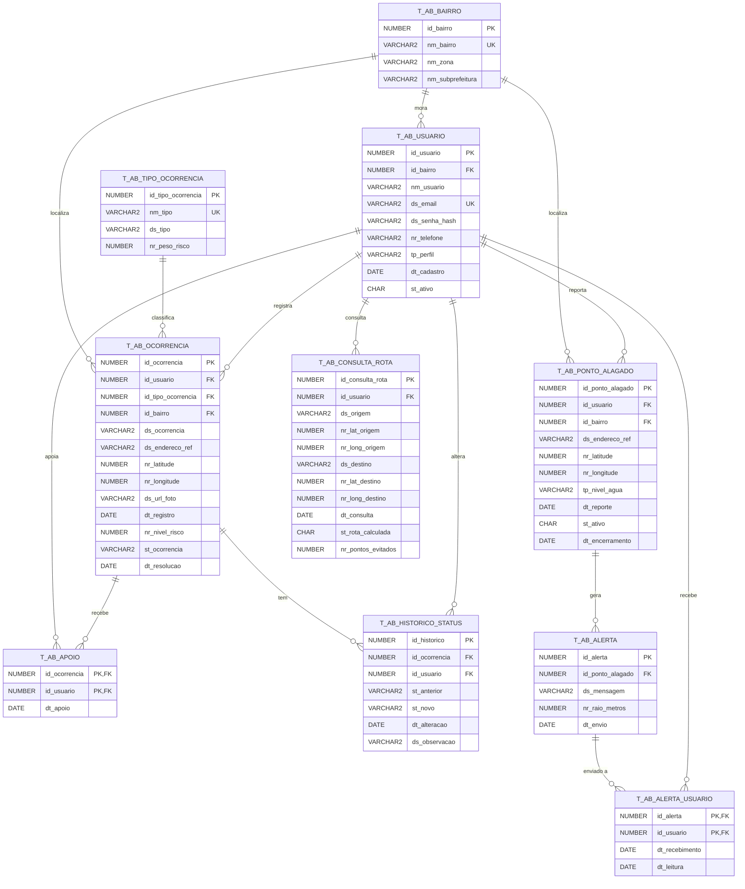

# AlertaBairro API — "Informe. Previna. Desvie."

API REST em **Java 21 + Spring Boot 3** do **AlertaBairro**, projeto da **Global Solution 2026.2 (FIAP — CitizenTech)** na disciplina **Domain Driven Design — Java**.

O AlertaBairro junta a **zeladoria do bairro** (bueiros entupidos, bocas de lobo danificadas, lixo e entulho), o **alerta de alagamento** e a **rota segura** para os bairros da Subprefeitura Santana/Tucuruvi (zona norte de São Paulo).

> **O modelo de dados é o mesmo da entrega de Database do grupo:** as 10 tabelas `T_AB_*` do DDL oficial, sem nenhuma alteração. A API só acrescenta sequences e dados de teste num script separado.

- **Link do deploy (Render):** `https://alertabairro-api.onrender.com` ← preencher
- **Swagger:** `https://alertabairro-api.onrender.com/swagger-ui.html`
- **Health check:** `https://alertabairro-api.onrender.com/api/health`
- **Repositório:** https://github.com/AlertaBairro/DDD-Java-GSCitizenTech

## Integrantes

| Nome | RM |
|---|---|
| Arthur Araújo Tenório | RM562272 |
| Breno Gonçalves Báo | RM564037 |
| Rafael Falaguasta Ferraz | RM561714 |
| Vinicius Cavalcanti dos Reis | RM562063 |

Turma: **2ESPG**

---

## 1. O problema e a solução

Em dias de chuva, bueiros entupidos e bocas de lobo danificadas viram pontos de alagamento, e o morador só descobre que a rua alagou quando já está nela. A prefeitura recebe reclamações espalhadas e não sabe o que atender primeiro.

| Perfil | O que faz |
|---|---|
| **Morador** | Registra ocorrências de zeladoria, apoia ocorrências de vizinhos, reporta pontos alagados (que geram alertas para o bairro), lê seus alertas e consulta a rota mais segura. |
| **Agente de zeladoria** | Vê as ocorrências **ordenadas por prioridade**, muda o status (com histórico) e encerra pontos alagados. |
| **Gestor da subprefeitura** | Vê os indicadores: pendências, tempo médio de resolução, números por bairro e tipo, alertas e taxa de leitura, e **reincidência**. Também encerra pontos alagados. |

## 2. Onde está cada item da rubrica

| Item da rubrica | Pontos | Onde está |
|---|---|---|
| Camada **modelo** com todas as classes, **de acordo com o banco de dados** | 10 | [`model/`](src/main/java/br/com/fiap/alertabairro/model): uma classe por tabela do DDL do grupo (`Bairro`, `Usuario`, `TipoOcorrencia`, `Ocorrencia`, `Apoio`, `HistoricoStatus`, `PontoAlagado`, `Alerta`, `AlertaUsuario`, `ConsultaRota`) e um enum por CHECK (`Zona`, `Perfil`, `StatusOcorrencia`, `NivelAgua`). DDL em [`db/01_ddl.sql`](src/main/resources/db/01_ddl.sql). |
| Camadas **DAO** e **BO** | 10 | [`dao/`](src/main/java/br/com/fiap/alertabairro/dao): JDBC puro, um DAO por tabela, IDs por sequence, operações compostas em transação. [`bo/`](src/main/java/br/com/fiap/alertabairro/bo): todas as regras de negócio. |
| **Controller** com GET, POST, PUT e DELETE | 10 | [`controller/`](src/main/java/br/com/fiap/alertabairro/controller): 24 rotas e 31 operações (ver seção 9). |
| **Tratamento de exceções** | 10 | [`exception/`](src/main/java/br/com/fiap/alertabairro/exception): exceções próprias, [`GlobalExceptionHandler`](src/main/java/br/com/fiap/alertabairro/exception/GlobalExceptionHandler.java) (`@RestControllerAdvice`) e [`TradutorErroOracle`](src/main/java/br/com/fiap/alertabairro/exception/TradutorErroOracle.java), que converte ORA-00001, ORA-02290, ORA-02291 e ORA-02292 em 409/422. |
| **Deploy** no Render | 30 | [`Dockerfile`](Dockerfile), [`render.yaml`](render.yaml) e o passo a passo da seção 7. |

Extras:
- DTOs com Bean Validation ([`dto/`](src/main/java/br/com/fiap/alertabairro/dto));
- CORS e Swagger ([`config/`](src/main/java/br/com/fiap/alertabairro/config));
- **86 testes unitários** ([`src/test`](src/test/java/br/com/fiap/alertabairro));
- exemplos de todas as rotas em [`requests.http`](requests.http).

## 3. Arquitetura em camadas

```
Controller  →  BO (regras de negócio)  →  DAO (JDBC)  →  Oracle (tabelas T_AB_*)
    ↑                 ↑                      ↑
   DTO             model                ConnectionFactory (DB_URL, DB_USER, DB_PASSWORD)
    ↓
exception (GlobalExceptionHandler + TradutorErroOracle → JSON padronizado)
```

- **Controller:** só recebe a requisição, valida o DTO (`@Valid`) e chama o **BO**.
- **BO:** confere a autenticação e o perfil, aplica as regras e chama os **DAOs**.
- **DAO:**
  - usa `Connection`, `PreparedStatement` e `ResultSet`, com os nomes exatos de tabelas e colunas do DDL;
  - quando uma operação mexe em várias tabelas, roda tudo na mesma transação (`setAutoCommit(false)`, `commit` e `rollback`).
- As credenciais do banco vêm de **variáveis de ambiente** e nunca são versionadas.

```
src/main/java/br/com/fiap/alertabairro
├── model/        10 classes (uma por tabela) + enums Zona, Perfil, StatusOcorrencia, NivelAgua, NivelRisco
├── dto/          records de entrada/saída com Bean Validation
├── dao/          ConnectionFactory, JdbcUtils (transações/sequences), 1 DAO por tabela, IndicadorDAO, HealthDAO
├── bo/           UsuarioBO, CatalogoBO, OcorrenciaBO, ApoioBO, RiscoBO, PontoAlagadoBO, AlertaBO, RotaBO, IndicadorBO, HealthBO
├── controller/   Auth, Usuario, Catalogo, Ocorrencia, PontoAlagado, Alerta, Rota, Indicador, Health
├── exception/    exceções próprias + GlobalExceptionHandler + TradutorErroOracle + ErroResposta
└── config/       CORS, OpenAPI, BCrypt e Clock
src/main/resources/db
├── 01_ddl.sql                 DDL do grupo (cópia exata)
├── 02_dml.sql                 DML do grupo (cópia exata)
├── 03_api_complemento.sql     sequences + usuários de teste + dados de demonstração
├── 04_drop_api.sql            desfaz o 03
├── 05_dql.sql                 DQL do grupo (cópia exata)
└── 99_drop_esquema_antigo.sql remove as tabelas AB_* da primeira versão da API
```

## 4. Modelo de dados

### Diagrama entidade-relacionamento (10 tabelas do grupo)



**CHECKs do DDL respeitados pela API:**
- zona, perfil, status, nível da água e `S`/`N`;
- faixas de latitude e longitude;
- peso e nível de risco entre 1 e 5;
- RESOLVIDA ⇔ data de resolução (`CK_AB_OCORRENCIA_RESOL`);
- ativo ⇔ sem data de encerramento (`CK_AB_PONTO_ATIVO`);
- status anterior diferente do novo no histórico;
- leitura nunca antes do recebimento;
- pontos evitados ≥ 0.

As FKs **não têm cascade**, por isso a exclusão de ocorrência remove antes os apoios e o histórico, na mesma transação.

### Mapeamento tabela → classe

| Tabela | Classe | Observações |
|---|---|---|
| `T_AB_BAIRRO` | `Bairro` | enum `Zona` (NORTE, SUL, LESTE, OESTE, CENTRO) |
| `T_AB_USUARIO` | `Usuario` | enum `Perfil`; `ativo` boolean ↔ `st_ativo` 'S'/'N'; bairro obrigatório; telefone opcional |
| `T_AB_TIPO_OCORRENCIA` | `TipoOcorrencia` | lido do banco; `pesoRisco` 1–5 |
| `T_AB_OCORRENCIA` | `Ocorrencia` | enum `StatusOcorrencia` (ABERTA, RECEBIDA, EM_ATENDIMENTO, RESOLVIDA); `quantidadeApoios` é contada em `T_AB_APOIO` |
| `T_AB_APOIO` | `Apoio` | chave composta (ocorrência + usuário) |
| `T_AB_HISTORICO_STATUS` | `HistoricoStatus` | agente, status anterior e novo, observação |
| `T_AB_PONTO_ALAGADO` | `PontoAlagado` | enum `NivelAgua` (TORNOZELO, JOELHO, CINTURA, INTRANSITAVEL) |
| `T_AB_ALERTA` | `Alerta` | mensagem e raio de divulgação |
| `T_AB_ALERTA_USUARIO` | `AlertaUsuario` | chave composta (alerta + usuário); `dt_leitura` |
| `T_AB_CONSULTA_ROTA` | `ConsultaRota` | `rotaCalculada` ↔ 'S'/'N' |

Tipos: `DATE` → `LocalDateTime`, `NUMBER(9,6)` → `double` (gravado com 6 casas), `CHAR(1)` → `boolean`. Os IDs vêm das sequences `SQ_AB_*` criadas pelo `03_api_complemento.sql`.

## 5. Regras de negócio (camada BO)

| # | Regra | Onde |
|---|---|---|
| 1 | **Cadastro** (público): nome, e-mail único (409), senha em BCrypt, telefone opcional, bairro obrigatório (422 se não existir) e perfil. Entra ativo. | `UsuarioBO.cadastrar` |
| 2 | **Login:** só autentica usuário existente, ativo e com senha BCrypt válida (401). **Não cria conta.** Devolve id, nome, perfil e bairro. | `UsuarioBO.login` |
| 3 | **Excluir usuário** (o próprio): **exclusão lógica** (`st_ativo = 'N'`). Usuário inativo não loga nem usa o header. | `UsuarioBO.excluir` |
| 4 | **Registrar ocorrência** (MORADOR): tipo, bairro, endereço, latitude e longitude obrigatórios; descrição até 500; foto (URL) opcional. Nasce **ABERTA** com `nivelRisco` = peso do tipo. O autor **não** apoia a própria. | `OcorrenciaBO.registrar` |
| 5 | **Editar / excluir:** só o autor (403) e só enquanto **ABERTA** (422). A exclusão remove apoios + histórico + ocorrência numa transação. | `OcorrenciaBO.editar/excluir` |
| 6 | **Apoiar / retirar** (MORADOR): um por usuário (409), nunca na própria (422) nem em RESOLVIDA (422). | `ApoioBO` |
| 7 | **Status** (AGENTE): diferente do atual e nunca de volta para ABERTA (422). Grava `T_AB_HISTORICO_STATUS` na **mesma transação**. RESOLVIDA preenche `dt_resolucao`; sair de RESOLVIDA limpa. | `OcorrenciaBO.alterarStatus` |
| 8 | **Priorização:** `nivelRisco × 2 + apoios + dias × 0,8` (resolvida = 0). ALTO ≥ 16, MÉDIO ≥ 10. Decrescente; no empate, a mais recente. | `RiscoBO` |
| 9 | **Reportar ponto alagado** (MORADOR): na **mesma transação**: ponto ativo, alerta (mensagem gerada, raio TORNOZELO 300 m / JOELHO 500 m / CINTURA 600 m / INTRANSITAVEL 800 m) e destinatários (usuários ativos do bairro, menos quem reportou). | `PontoAlagadoBO.reportar` |
| 10 | **Encerrar ponto** (AGENTE ou GESTOR): `st_ativo = 'N'` e `dt_encerramento` = agora. | `PontoAlagadoBO.encerrar` |
| 11 | **Alertas:** ativos (de pontos ativos), os do usuário (lidos e não lidos) e marcar como lido (`dt_leitura`). | `AlertaBO` |
| 12 | **Zonas de risco:** pontos alagados ativos com raio de desvio de **40 m** (diferente do raio do alerta). | `RotaBO.listarZonasDeRisco` |
| 13 | **Avaliar rota:** distância ponto–polilinha ≤ 40 m; mais segura = menos zonas, no empate menor duração. **Grava `T_AB_CONSULTA_ROTA`** (`st_rota_calculada`, `nr_pontos_evitados` = zonas da rota padrão − zonas da segura, mínimo 0). | `RotaBO.avaliar` |
| 14 | **Indicadores** (GESTOR): totais e pendentes, tempo médio de resolução, por bairro (consulta 2 do DQL), por tipo, pontos alagados, alertas, usuários alertados, taxa de leitura e reincidências. | `IndicadorBO` + `IndicadorDAO` |

**Autenticação simples:** o login devolve o `id` e as demais requisições enviam o header **`X-Usuario-Id`**. O BO confere se o usuário existe, se está ativo e se o perfil tem permissão. Não há Spring Security nem JWT, para manter o deploy simples.

## 6. Como rodar localmente

Pré-requisito: **Java 21**. O Maven Wrapper (`./mvnw`) já baixa o Maven.

### 6.1 Criar as tabelas no Oracle da FIAP

No SQL Developer, conectado com o seu usuário da FIAP, execute **nesta ordem** com F5 ("Executar script"):

| Ordem | Script | O que faz |
|---|---|---|
| (opcional) | `99_drop_esquema_antigo.sql` | remove as tabelas `AB_*` da primeira versão da API, se existirem |
| 1 | `01_ddl.sql` | DDL do grupo: cria as 10 tabelas `T_AB_*` |
| 2 | `02_dml.sql` | DML do grupo: dados de exemplo |
| 3 | `03_api_complemento.sql` | sequences `SQ_AB_*`, usuários de teste e dados de demonstração |

Todos ficam em `src/main/resources/db/`.

> **ORA-00942 na primeira execução é esperado.** O `01_ddl.sql` começa com `DROP TABLE ... CASCADE CONSTRAINTS` para poder ser executado de novo. Na primeira vez as tabelas ainda não existem, então cada `DROP` mostra *ORA-00942: a tabela ou view não existe*. O SQL Developer continua o script e os `CREATE TABLE` seguintes funcionam normalmente.

Para refazer tudo do zero, rode de novo `01`, `02` e `03`. Para remover só o que a API acrescentou, rode `04_drop_api.sql`. O `05_dql.sql` traz as consultas do grupo e é opcional.

### 6.2 Configurar as variáveis de ambiente

Nunca coloque usuário e senha no código. Defina as variáveis antes de subir a API.

**PowerShell (Windows):**
```powershell
$env:DB_URL = "jdbc:oracle:thin:@oracle.fiap.com.br:1521:ORCL"
$env:DB_USER = "rmXXXXX"
$env:DB_PASSWORD = "sua_senha"
```

**Bash (Linux, macOS ou Git Bash):**
```bash
export DB_URL="jdbc:oracle:thin:@oracle.fiap.com.br:1521:ORCL"
export DB_USER="rmXXXXX"
export DB_PASSWORD="sua_senha"
```

Opcionais:
- `CORS_ORIGINS`: origens do front separadas por vírgula. Padrão: `http://localhost:*,http://127.0.0.1:*`.
- `PORT`: padrão 8080.

### 6.3 Testar, compilar e subir

```bash
./mvnw test                 # 86 testes unitários (não precisam do banco)
./mvnw clean package        # gera target/alertabairro-api.jar
java -jar target/alertabairro-api.jar
```

Depois acesse:
- `http://localhost:8080/api/health`, que deve mostrar `"banco": "UP"`;
- `http://localhost:8080/swagger-ui.html`.

## 7. Deploy no Render (passo a passo)

1. Garanta que todos os commits estão no GitHub, na branch `main`.
2. Acesse https://dashboard.render.com e faça login com o GitHub.
3. Clique em **New → Web Service** e escolha o repositório `DDD-Java-GSCitizenTech`. Como alternativa, **New → Blueprint** lê o [`render.yaml`](render.yaml) e já preenche tudo.
4. Configure:
   - **Language/Runtime:** `Docker` (o Render usa o [`Dockerfile`](Dockerfile) da raiz);
   - **Branch:** `main`;
   - **Instance type:** `Free`.
5. Em **Environment Variables**, cadastre:

   | Chave | Valor |
   |---|---|
   | `DB_URL` | `jdbc:oracle:thin:@oracle.fiap.com.br:1521:ORCL` |
   | `DB_USER` | seu usuário do Oracle FIAP (ex.: `rm555555`) |
   | `DB_PASSWORD` | sua senha do Oracle FIAP |
   | `CORS_ORIGINS` | URL do front (ex.: `https://alertabairro.vercel.app,http://localhost:*`) |
   | `TZ` | `America/Sao_Paulo` |
6. Em **Advanced → Health Check Path**, informe `/api/health`.
7. Clique em **Create Web Service** e acompanhe os logs do build. A primeira vez leva alguns minutos.
8. Teste a URL pública:
   - `https://<seu-servico>.onrender.com/api/health` deve responder `{"status":"UP","banco":"UP",...}`;
   - `https://<seu-servico>.onrender.com/swagger-ui.html` deve abrir o Swagger.
9. Copie a URL pública para o topo deste README e para a documentação.

> No plano gratuito o serviço "dorme" depois de 15 minutos sem acesso, e a primeira requisição depois disso demora cerca de 50 segundos. Abra o `/api/health` antes de apresentar.

## 8. Usuários de teste (criados pelo `03_api_complemento.sql`)

| Perfil | E-mail | Senha | Id (banco recém-criado) |
|---|---|---|---|
| MORADOR | `morador@alertabairro.com` | `morador123` | 11 |
| AGENTE | `agente@alertabairro.com` | `agente123` | 12 |
| GESTOR | `gestor@alertabairro.com` | `gestor123` | 13 |

- **Senhas:** os três usam hash BCrypt real, conferido por um teste automatizado que lê o script.
- **Bairro:** os três moram no bairro 1 (Jardim São Paulo).
- **Ids:** os da tabela valem para um banco recém-criado; o id certo sempre volta no login.
- **Usuários do DML:** os hashes do DML do grupo são fictícios, então esses usuários não conseguem logar. Para testar com outra conta, use `POST /api/usuarios`.

O complemento também cria dados para a demonstração:
- uma ocorrência **ABERTA** perto da Estação Jardim São Paulo, de outra moradora, que o morador de teste pode apoiar;
- o morador de teste como destinatário do alerta do **ponto alagado 6**, que está ativo.

## 9. Endpoints

Todas as rotas, exceto as públicas, exigem o header `X-Usuario-Id: <id devolvido no login>`.

| Método | Rota | Perfil | Descrição |
|---|---|---|---|
| GET | `/api/health` | público | status da API e do banco |
| GET | `/api/bairros` · `/api/bairros/{id}` | público | bairros |
| GET | `/api/tipos-ocorrencia` · `/api/tipos-ocorrencia/{id}` | público | tipos com peso de risco |
| POST | `/api/usuarios` | público | cadastro (201) |
| GET | `/api/usuarios/{id}` | o próprio | dados da conta |
| PUT | `/api/usuarios/{id}` | o próprio | nome, telefone, bairro e senha (opcional) |
| DELETE | `/api/usuarios/{id}` | o próprio | exclusão lógica (204) |
| POST | `/api/auth/login` | público | login (e-mail e senha) |
| GET | `/api/ocorrencias?bairro=&tipo=&status=` | autenticado | lista com filtros (ids de bairro e tipo) |
| GET | `/api/ocorrencias/{id}` | autenticado | detalhe |
| POST | `/api/ocorrencias` | MORADOR | registrar (201) |
| PUT | `/api/ocorrencias/{id}` | autor, se ABERTA | editar |
| DELETE | `/api/ocorrencias/{id}` | autor, se ABERTA | excluir (204) |
| POST | `/api/ocorrencias/{id}/apoios` | MORADOR | apoiar |
| DELETE | `/api/ocorrencias/{id}/apoios` | MORADOR | retirar apoio |
| GET | `/api/ocorrencias/priorizadas?bairro=&tipo=&status=` | AGENTE | fila por prioridade |
| PUT | `/api/ocorrencias/{id}/status` | AGENTE | alterar status + histórico |
| GET | `/api/ocorrencias/{id}/historico` | autenticado | histórico de status |
| GET | `/api/pontos-alagados?ativos=true` | autenticado | todos ou só os ativos |
| GET | `/api/pontos-alagados/{id}` | autenticado | detalhe |
| POST | `/api/pontos-alagados` | MORADOR | reportar (gera alerta e destinatários) (201) |
| PUT | `/api/pontos-alagados/{id}/encerrar` | AGENTE ou GESTOR | encerrar |
| GET | `/api/alertas` | autenticado | alertas ativos |
| GET | `/api/alertas/meus` | autenticado | alertas recebidos (lidos e não lidos) |
| PUT | `/api/alertas/{id}/leitura` | destinatário | marcar como lido |
| GET | `/api/zonas-de-risco` | autenticado | pontos alagados ativos com raio de 40 m |
| POST | `/api/rotas/avaliar` | autenticado | avalia rotas e grava a consulta |
| GET | `/api/rotas/minhas` | autenticado | histórico de consultas de rota |
| GET | `/api/indicadores` | GESTOR | painel do gestor |

### Exemplos

**Cadastro:** `POST /api/usuarios`
```json
{ "nome": "Maria da Silva", "email": "maria.silva@email.com", "senha": "1234",
  "telefone": "11988887777", "bairroId": 1, "perfil": "MORADOR" }
```

**Login:** `POST /api/auth/login`
```json
{ "email": "morador@alertabairro.com", "senha": "morador123" }
```
Resposta `200`:
```json
{ "id": 11, "nome": "Morador de Teste", "email": "morador@alertabairro.com", "perfil": "MORADOR",
  "perfilDescricao": "Morador", "bairro": { "id": 1, "nome": "Jardim São Paulo" },
  "mensagem": "Login realizado. Envie o header X-Usuario-Id: 11 nas próximas requisições." }
```

**Registrar ocorrência:** `POST /api/ocorrencias` com `X-Usuario-Id: 11`
```json
{ "tipoId": 3, "bairroId": 1, "enderecoReferencia": "Rua Dr. Zuquim, 950",
  "latitude": -23.4931, "longitude": -46.6178, "descricao": "Sacos de lixo sobre a boca de lobo" }
```
Resposta `201`, com header `Location: /api/ocorrencias/{id}`. A ocorrência vem com `status: "ABERTA"`, `nivelRisco: 3` (peso do tipo), `quantidadeApoios: 0`, `editavel: true` e a `prioridade` calculada.

**Alterar status:** `PUT /api/ocorrencias/9/status` com `X-Usuario-Id: 12` (agente)
```json
{ "status": "RECEBIDA", "observacao": "Ocorrência triada pela zeladoria" }
```

**Reportar ponto alagado:** `POST /api/pontos-alagados` com `X-Usuario-Id: 11`
```json
{ "bairroId": 1, "enderecoReferencia": "Rua Dr. Zuquim, 900",
  "latitude": -23.4935, "longitude": -46.6180, "nivelAgua": "JOELHO" }
```
Resposta `201`:
```json
{
  "ponto": { "id": 7, "nivelAgua": "JOELHO", "ativo": true, "...": "..." },
  "alerta": { "id": 7, "mensagem": "Alagamento com água na altura do joelho em Rua Dr. Zuquim, 900. Evite o trecho.",
              "raioMetros": 500, "pontoAtivo": true, "...": "..." },
  "usuariosNotificados": 5
}
```

**Avaliar rotas:** `POST /api/rotas/avaliar`. A primeira rota da lista é a rota padrão.
```json
{
  "origem":  { "descricao": "Rua Dr. Zuquim, 900", "latitude": -23.4935, "longitude": -46.6180 },
  "destino": { "descricao": "Estação Jardim São Paulo-Ayrton Senna", "latitude": -23.4910, "longitude": -46.6160 },
  "rotas": [
    { "nome": "Pela avenida", "coordenadas": [[-23.4932, -46.6166], [-23.4912, -46.6166]],
      "duracaoSegundos": 120, "distanciaMetros": 220 },
    { "nome": "Desvio", "coordenadas": [[-23.4932, -46.6146], [-23.4912, -46.6146]],
      "duracaoSegundos": 180, "distanciaMetros": 300 }
  ]
}
```
Resposta `200`: `indiceMaisSegura: 1`, `pontosEvitados: 1` e `consultaId`. A consulta fica gravada em `T_AB_CONSULTA_ROTA`.

Mais exemplos em [`requests.http`](requests.http), que funciona com a extensão REST Client do VS Code ou com o HTTP Client do IntelliJ.

## 10. Tratamento de exceções

Todas as respostas de erro seguem o mesmo formato:

```json
{
  "timestamp": "2026-11-12T14:29:52-03:00",
  "status": 422,
  "erro": "Unprocessable Entity",
  "mensagem": "Não é possível voltar uma ocorrência para ABERTA.",
  "caminho": "/api/ocorrencias/9/status"
}
```

| Exceção | HTTP | Quando |
|---|---|---|
| `ValidacaoException` / Bean Validation | 400 | dados inválidos; o campo `detalhes` lista os erros por campo |
| `NaoAutenticadoException` | 401 | sem header, usuário inexistente ou inativo, e-mail ou senha inválidos |
| `AcessoNegadoException` | 403 | perfil sem permissão ou recurso de outro usuário |
| `RecursoNaoEncontradoException` | 404 | ocorrência, ponto, alerta, bairro, tipo ou apoio inexistente |
| `ConflitoException` | 409 | e-mail já cadastrado, apoio duplicado, alteração concorrente; **ORA-00001** |
| `RegraDeNegocioException` | 422 | regra violada (status, edição fora de ABERTA, apoio na própria...); **ORA-02290, ORA-02291, ORA-02292** |
| `PersistenciaException` / qualquer outra | 500 | falha no banco ou erro inesperado (o detalhe fica só no log) |

O [`TradutorErroOracle`](src/main/java/br/com/fiap/alertabairro/exception/TradutorErroOracle.java) lê o código ORA e o nome da constraint e devolve uma mensagem clara. Por exemplo, `UK_AB_USUARIO_EMAIL` vira "Já existe um usuário cadastrado com este e-mail." e `PK_AB_APOIO` vira "Você já apoiou esta ocorrência.".

## 11. Tecnologias

Java 21, Spring Boot 3.3 (Web e Validation), JDBC puro com o driver `ojdbc11`, HikariCP, BCrypt (`spring-security-crypto`, sem Spring Security), springdoc-openapi (Swagger UI), JUnit 5, Mockito, AssertJ, Docker e Render.
