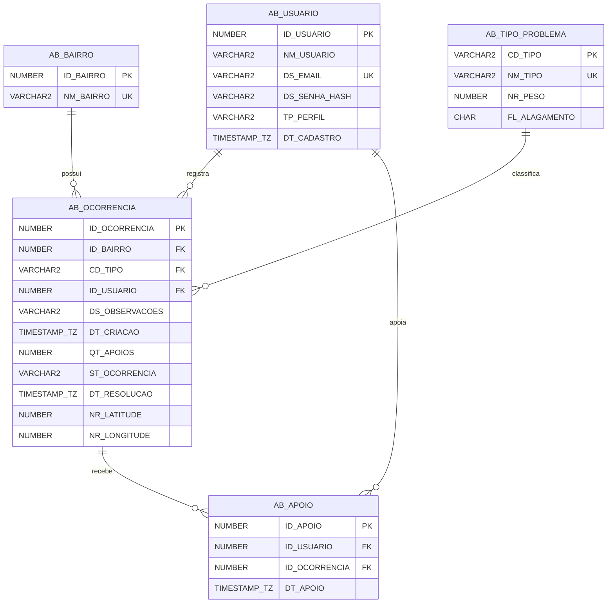
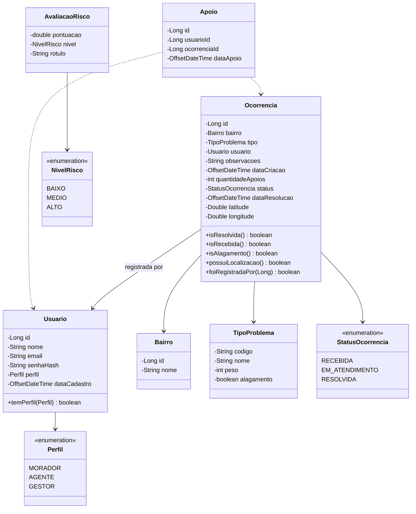

# AlertaBairro API — "Informe. Previna. Desvie."

API REST em **Java 21 + Spring Boot 3** do **AlertaBairro**, projeto da **Global Solution 2026.2 (FIAP — CitizenTech)** na disciplina **Domain Driven Design — Java**.

O AlertaBairro junta a **zeladoria do bairro** (bueiros entupidos, bocas de lobo danificadas, lixo acumulado), o **alerta de alagamento** e a **rota segura** para os bairros de Santana, Jardim São Paulo e Tucuruvi (zona norte de São Paulo). O protótipo do front em HTML/JS guardava tudo no `localStorage`; esta API substitui esse armazenamento por um banco **Oracle** e concentra as regras de negócio.

- **Link do deploy (Render):** `https://________________.onrender.com` ← preencher
- **Swagger:** `https://________________.onrender.com/swagger-ui.html`
- **Health check:** `https://________________.onrender.com/api/health`
- **Repositório:** https://github.com/AlertaBairro/DDD-Java-GSCitizenTech

## Integrantes

| Nome | RM |
|---|---|
| ________________________ | RM______ |
| ________________________ | RM______ |
| ________________________ | RM______ |

Turma: **2ESPG**

---

## 1. O problema e a solução

Em dias de chuva, bueiros entupidos e bocas de lobo danificadas viram pontos de alagamento, e o morador só descobre que a rua alagou quando já está nela. A prefeitura, por sua vez, recebe reclamações espalhadas e não sabe o que atender primeiro.

O AlertaBairro tem três perfis:

| Perfil | O que faz |
|---|---|
| **Morador** | Registra ocorrências (com ou sem ponto no mapa), apoia ocorrências de outros moradores, vê alertas de alagamento ativos e avalia a rota mais segura. |
| **Agente de zeladoria** | Vê as ocorrências **ordenadas por risco** e atualiza o status (Recebida → Em atendimento → Resolvida). |
| **Gestor da subprefeitura** | Vê os indicadores de impacto: totais, tempo médio de resolução, alertas e **reincidência** (mesmo problema no mesmo bairro). |

## 2. Onde está cada item da rubrica

| Item da rubrica | Pontos | Onde está |
|---|---|---|
| Camada **modelo** de acordo com o banco (Oracle FIAP) | 10 | [`model/`](src/main/java/br/com/fiap/alertabairro/model) — `Usuario`, `Ocorrencia`, `Apoio`, `Bairro`, `TipoProblema`, enums `Perfil`, `StatusOcorrencia`, `NivelRisco` + [`db/01_ddl.sql`](src/main/resources/db/01_ddl.sql) |
| Camadas **DAO** e **BO** | 10 | [`dao/`](src/main/java/br/com/fiap/alertabairro/dao) (JDBC puro + `ConnectionFactory`) e [`bo/`](src/main/java/br/com/fiap/alertabairro/bo) (regras de negócio) |
| **Controller** com GET, POST, PUT e DELETE | 10 | [`controller/`](src/main/java/br/com/fiap/alertabairro/controller) — ver tabela de endpoints |
| **Tratamento de exceções** | 10 | [`exception/`](src/main/java/br/com/fiap/alertabairro/exception) — exceções próprias + [`GlobalExceptionHandler`](src/main/java/br/com/fiap/alertabairro/exception/GlobalExceptionHandler.java) (`@RestControllerAdvice`) |
| **Deploy** no Render | 30 | [`Dockerfile`](Dockerfile), [`render.yaml`](render.yaml) e o passo a passo da seção 7 |

Também há: DTOs com Bean Validation ([`dto/`](src/main/java/br/com/fiap/alertabairro/dto)), CORS e Swagger ([`config/`](src/main/java/br/com/fiap/alertabairro/config)), 54 testes unitários dos BOs ([`src/test`](src/test/java/br/com/fiap/alertabairro/bo)) e exemplos de requisição ([`requests.http`](requests.http)).

## 3. Arquitetura em camadas

```
Controller  →  BO (regras de negócio)  →  DAO (JDBC)  →  Oracle
    ↑                 ↑                      ↑
   DTO             model                ConnectionFactory (DB_URL, DB_USER, DB_PASSWORD)
    ↓
exception (GlobalExceptionHandler → JSON padronizado)
```

- O **Controller** só recebe a requisição, valida o DTO (`@Valid`) e chama o **BO**.
- O **BO** valida permissões por perfil, aplica as regras e chama o **DAO**. Regras **nunca** ficam no Controller nem no DAO.
- O **DAO** usa `Connection`, `PreparedStatement` e `ResultSet` (uma classe por tabela, com CRUD completo).
- As credenciais do banco vêm de **variáveis de ambiente** e nunca são versionadas.

```
src/main/java/br/com/fiap/alertabairro
├── AlertaBairroApplication.java
├── model/        Usuario, Ocorrencia, Apoio, Bairro, TipoProblema, AvaliacaoRisco, enums
├── dto/          records de entrada/saída com Bean Validation
├── dao/          ConnectionFactory, UsuarioDAO, OcorrenciaDAO, ApoioDAO, BairroDAO, TipoProblemaDAO, HealthDAO
├── bo/           UsuarioBO, OcorrenciaBO, ApoioBO, RiscoBO, RotaBO, IndicadorBO, ReferenciaBO, HealthBO
├── controller/   Auth, Usuario, Ocorrencia, Alerta, Rota, Indicador, Referencia, Health
├── exception/    exceções próprias + GlobalExceptionHandler + ErroResposta
└── config/       CORS, OpenAPI, BCrypt e Clock
src/main/resources/db
├── 00_drop.sql   limpeza
├── 01_ddl.sql    criação das tabelas
└── 02_seed.sql   dados iniciais
```

## 4. Modelo de dados

### Diagrama entidade-relacionamento



Restrições: IDENTITY nas chaves numéricas, `UNIQUE (ID_USUARIO, ID_OCORRENCIA)` em `AB_APOIO`, `CHECK` de perfil, status, peso, faixas de latitude/longitude, localização completa (as duas ou nenhuma) e coerência entre status `RESOLVIDA` e data de resolução. Os apoios são removidos em cascata com a ocorrência.

### Diagrama de classes (camada model)



## 5. Regras de negócio (camada BO)

| # | Regra | Onde |
|---|---|---|
| 1 | Registrar ocorrência: só **MORADOR**; bairro e tipo obrigatórios; nasce **RECEBIDA** com **1 apoio** (do autor); data do sistema; latitude entre -90 e 90 e longitude entre -180 e 180 | `OcorrenciaBO.registrar` |
| 2 | Editar: só o autor e só enquanto **RECEBIDA** | `OcorrenciaBO.editar` |
| 3 | Excluir: só o autor e só enquanto **RECEBIDA**; apoios removidos junto | `OcorrenciaBO.excluir` |
| 4 | Apoiar: só **MORADOR**; um apoio por usuário (**409**); não apoia **RESOLVIDA** (**422**); +1 no contador. Retirar apoio: -1 | `ApoioBO` |
| 5 | Alterar status: só **AGENTE**; ao ir para RESOLVIDA grava a data de resolução; ao sair, limpa | `OcorrenciaBO.alterarStatus` |
| 6 | Risco: RESOLVIDA = 0 / BAIXO / "Resolvido". Senão `peso*2 + apoios + dias*0.8`; `>=16` ALTO, `>=10` MÉDIO, abaixo BAIXO. Lista do agente por pontuação desc. e, no empate, mais recente | `RiscoBO` |
| 7 | Alertas ativos: ALAGADO não resolvidas, mais recentes primeiro | `OcorrenciaBO.listarAlertasAtivos` |
| 8 | Zonas de risco: ALAGADO não resolvidas com localização, raio de 40 m | `RotaBO.listarZonasDeRisco` |
| 9 | Avaliação de rota: zona atravessada se distância até a polilinha ≤ 40 m (110540 m/grau de lat, 111320·cos(lat) m/grau de lng, ponto a segmento). Mais segura: menos zonas e, no empate, menor duração | `RotaBO.avaliar` |
| 10 | Indicadores do gestor: total, em aberto, tempo médio de resolução, alertas, por bairro, por tipo, por status e reincidência (bairro + tipo com mais de 1 ocorrência) | `IndicadorBO` |
| 11 | Login: valida e-mail e senha; BCrypt; e-mail novo cria a conta com o perfil escolhido; nome derivado do e-mail em Title Case | `UsuarioBO.login` |

**Autenticação simples:** o login devolve `id`, `nome` e `perfil`; as demais requisições enviam o header **`X-Usuario-Id`**. O BO confere se o perfil tem permissão. Sem Spring Security nem JWT, para manter o deploy simples.

## 6. Como rodar localmente

Pré-requisitos: **Java 21** (o Maven Wrapper `./mvnw` já baixa o Maven).

### 6.1 Criar as tabelas no Oracle da FIAP

No SQL Developer, conectado com o seu usuário da FIAP, execute **em ordem** (F5, "Executar script"):

1. `src/main/resources/db/00_drop.sql` (só se já existirem tabelas `AB_`)
2. `src/main/resources/db/01_ddl.sql`
3. `src/main/resources/db/02_seed.sql`

### 6.2 Configurar as variáveis de ambiente

Nunca coloque usuário e senha no código. Defina no terminal antes de subir a API:

**PowerShell (Windows):**
```powershell
$env:DB_URL = "jdbc:oracle:thin:@oracle.fiap.com.br:1521:ORCL"
$env:DB_USER = "rmXXXXX"
$env:DB_PASSWORD = "sua_senha"
```

**Bash (Linux/macOS/Git Bash):**
```bash
export DB_URL="jdbc:oracle:thin:@oracle.fiap.com.br:1521:ORCL"
export DB_USER="rmXXXXX"
export DB_PASSWORD="sua_senha"
```

Opcional: `CORS_ORIGINS` (origens do front separadas por vírgula; padrão `http://localhost:*,http://127.0.0.1:*`) e `PORT` (padrão 8080).

No IntelliJ: *Run → Edit Configurations → Environment variables*.

### 6.3 Testar, compilar e subir

```bash
./mvnw test                 # 54 testes unitários dos BOs (não precisam do banco)
./mvnw clean package        # gera target/alertabairro-api.jar
java -jar target/alertabairro-api.jar
```

Acesse `http://localhost:8080/api/health` (deve mostrar `"banco": "UP"`) e `http://localhost:8080/swagger-ui.html`.

## 7. Deploy no Render (passo a passo)

1. Garanta que todos os commits estão no GitHub (branch `main`).
2. Acesse https://dashboard.render.com e faça login com o GitHub.
3. Clique em **New → Web Service** e escolha o repositório `DDD-Java-GSCitizenTech`.
   - Alternativa: **New → Blueprint**, que lê o [`render.yaml`](render.yaml) e já preenche tudo.
4. Configure:
   - **Language/Runtime:** `Docker` (o Render usa o [`Dockerfile`](Dockerfile) da raiz)
   - **Branch:** `main`
   - **Instance type:** `Free`
5. Em **Environment Variables**, cadastre:
   | Chave | Valor |
   |---|---|
   | `DB_URL` | `jdbc:oracle:thin:@oracle.fiap.com.br:1521:ORCL` |
   | `DB_USER` | seu usuário do Oracle FIAP (ex.: `rm555555`) |
   | `DB_PASSWORD` | sua senha do Oracle FIAP |
   | `CORS_ORIGINS` | URL do front (ex.: `https://alertabairro.vercel.app,http://localhost:*`) |
6. Em **Advanced → Health Check Path**, informe `/api/health`.
7. Clique em **Create Web Service** e acompanhe os logs do build (a primeira vez leva alguns minutos).
8. Teste a URL pública:
   - `https://<seu-servico>.onrender.com/api/health` → `{"status":"UP","banco":"UP",...}`
   - `https://<seu-servico>.onrender.com/swagger-ui.html`
9. Copie a URL pública para o topo deste README e para a documentação.

> No plano gratuito o serviço "dorme" após 15 minutos sem acesso; a primeira requisição depois disso demora cerca de 50 segundos. Abra o `/api/health` antes de apresentar.

## 8. Credenciais de teste (criadas pelo `02_seed.sql`)

| Perfil | E-mail | Senha |
|---|---|---|
| MORADOR | `morador@alertabairro.com` | `morador123` |
| AGENTE | `agente@alertabairro.com` | `agente123` |
| GESTOR | `gestor@alertabairro.com` | `gestor123` |
| MORADOR (autor das 6 ocorrências de exemplo) | `comunidade@alertabairro.com` | `comunidade123` |

Qualquer outro e-mail válido cria uma conta nova no primeiro login, como no protótipo.

## 9. Endpoints

Todas as rotas marcadas como "autenticado" exigem o header `X-Usuario-Id: <id devolvido no login>`.

| Método | Rota | Perfil | Descrição |
|---|---|---|---|
| GET | `/api/health` | público | status da API e do banco |
| POST | `/api/auth/login` | público | login (e-mail, senha, perfil) |
| GET | `/api/usuarios/{id}` | autenticado | dados do usuário |
| PUT | `/api/usuarios/{id}` | o próprio | atualizar nome/senha |
| DELETE | `/api/usuarios/{id}` | o próprio | excluir conta |
| GET | `/api/referencias` | público | bairros, tipos (com peso), status, perfis e ponto de referência |
| GET | `/api/ocorrencias?bairro=&tipo=&status=` | autenticado | lista com filtros, mais recentes primeiro |
| GET | `/api/ocorrencias/{id}` | autenticado | detalhe |
| POST | `/api/ocorrencias` | MORADOR | registrar |
| PUT | `/api/ocorrencias/{id}` | autor, se RECEBIDA | editar |
| DELETE | `/api/ocorrencias/{id}` | autor, se RECEBIDA | excluir |
| POST | `/api/ocorrencias/{id}/apoios` | MORADOR | apoiar (409 se já apoiou; 422 se resolvida) |
| DELETE | `/api/ocorrencias/{id}/apoios` | MORADOR | retirar apoio |
| GET | `/api/ocorrencias/priorizadas?bairro=&tipo=&status=` | AGENTE | lista ordenada por risco |
| PUT | `/api/ocorrencias/{id}/status` | AGENTE | alterar status |
| GET | `/api/alertas` | autenticado | alertas de alagamento ativos |
| GET | `/api/zonas-de-risco` | autenticado | pontos alagados ativos + raio |
| POST | `/api/rotas/avaliar` | autenticado | avalia rotas candidatas e indica a mais segura |
| GET | `/api/indicadores` | GESTOR | KPIs, contagens e reincidência |

### Exemplos

**Login** — `POST /api/auth/login`
```json
{ "email": "morador@alertabairro.com", "senha": "morador123", "perfil": "MORADOR" }
```
Resposta `200`:
```json
{ "id": 1, "nome": "Morador", "email": "morador@alertabairro.com", "perfil": "MORADOR",
  "perfilDescricao": "Morador", "novoUsuario": false }
```

**Registrar ocorrência** — `POST /api/ocorrencias` com `X-Usuario-Id: 1`
```json
{ "bairroId": 2, "tipo": "ALAGADO", "observacoes": "Água na altura do tornozelo.",
  "latitude": -23.4927, "longitude": -46.6168 }
```
Resposta `201` (header `Location: /api/ocorrencias/7`):
```json
{
  "id": 7,
  "bairro": { "id": 2, "nome": "Jardim São Paulo" },
  "tipo": { "codigo": "ALAGADO", "nome": "Ponto alagado", "peso": 5, "alagamento": true },
  "observacoes": "Água na altura do tornozelo.",
  "dataCriacao": "2026-11-12T14:35:00-03:00",
  "apoios": 1,
  "status": "RECEBIDA",
  "statusDescricao": "Recebida",
  "dataResolucao": null,
  "latitude": -23.4927,
  "longitude": -46.6168,
  "autor": { "id": 1, "nome": "Morador" },
  "apoiadaPorMim": true,
  "minhaOcorrencia": true,
  "editavel": true,
  "risco": { "pontuacao": 11.0, "nivel": "MEDIO", "nivelDescricao": "Médio", "rotulo": "Risco médio" }
}
```

**Alterar status** — `PUT /api/ocorrencias/7/status` com `X-Usuario-Id` do agente
```json
{ "status": "RESOLVIDA" }
```

**Avaliar rotas** — `POST /api/rotas/avaliar`
```json
{
  "rotas": [
    { "nome": "Rota 1", "coordenadas": [[-23.4937, -46.6168], [-23.4917, -46.6168]],
      "duracaoSegundos": 120, "distanciaMetros": 220 },
    { "nome": "Rota 2", "coordenadas": [[-23.4937, -46.6148], [-23.4917, -46.6148]],
      "duracaoSegundos": 180, "distanciaMetros": 300 }
  ]
}
```
Resposta `200`:
```json
{
  "totalZonasDeRisco": 1,
  "raioMetros": 40.0,
  "indiceRotaMaisSegura": 1,
  "rotas": [
    { "indice": 0, "nome": "Rota 1", "zonasAtravessadas": 1, "ocorrenciasNoCaminho": [2],
      "duracaoSegundos": 120.0, "distanciaMetros": 220.0, "maisSegura": false },
    { "indice": 1, "nome": "Rota 2", "zonasAtravessadas": 0, "ocorrenciasNoCaminho": [],
      "duracaoSegundos": 180.0, "distanciaMetros": 300.0, "maisSegura": true }
  ]
}
```

**Indicadores** — `GET /api/indicadores` com `X-Usuario-Id` do gestor (dados do seed)
```json
{
  "totalOcorrencias": 6, "totalEmAberto": 4, "totalResolvidas": 2,
  "tempoMedioResolucaoHoras": 50.0, "tempoMedioResolucaoTexto": "2 d 2 h",
  "totalAlertasAlagamento": 1, "alertasAlagamentoAtivos": 1,
  "porBairro": [ { "codigo": "2", "nome": "Jardim São Paulo", "total": 3 }, "..." ],
  "porTipo": [ { "codigo": "BUEIRO", "nome": "Bueiro entupido", "total": 3 }, "..." ],
  "porStatus": [ { "codigo": "RECEBIDA", "nome": "Recebida", "total": 3 }, "..." ],
  "reincidencias": [ { "bairroId": 2, "bairro": "Jardim São Paulo", "tipo": "BUEIRO",
                       "tipoNome": "Bueiro entupido", "total": 2 } ]
}
```

Mais exemplos de todas as rotas em [`requests.http`](requests.http) (extensão REST Client do VS Code ou HTTP Client do IntelliJ).

## 10. Tratamento de exceções

Todas as respostas de erro seguem o mesmo formato:

```json
{
  "timestamp": "2026-11-12T14:29:52-03:00",
  "status": 409,
  "erro": "Conflict",
  "mensagem": "Você já apoiou esta ocorrência.",
  "caminho": "/api/ocorrencias/2/apoios"
}
```

| Exceção | HTTP | Quando |
|---|---|---|
| `ValidacaoException` / Bean Validation | 400 | dados inválidos (e-mail, faixa de coordenadas, campos obrigatórios); o campo `detalhes` lista os erros por campo |
| `NaoAutenticadoException` | 401 | sem header `X-Usuario-Id`, usuário inexistente ou senha errada |
| `AcessoNegadoException` | 403 | perfil sem permissão ou recurso de outro usuário |
| `RecursoNaoEncontradoException` | 404 | ocorrência, usuário, bairro, tipo ou apoio inexistente |
| `ConflitoException` | 409 | apoio duplicado |
| `RegraDeNegocioException` | 422 | editar/excluir fora de RECEBIDA, apoiar RESOLVIDA, mesmo status |
| `PersistenciaException` / qualquer outra | 500 | falha no banco ou erro inesperado (detalhe só no log) |

## 11. Tecnologias

Java 21 · Spring Boot 3.3 (Web, Validation) · JDBC puro + driver `ojdbc11` · HikariCP · BCrypt (`spring-security-crypto`, sem Spring Security) · springdoc-openapi (Swagger UI) · JUnit 5 + Mockito + AssertJ · Docker · Render.
