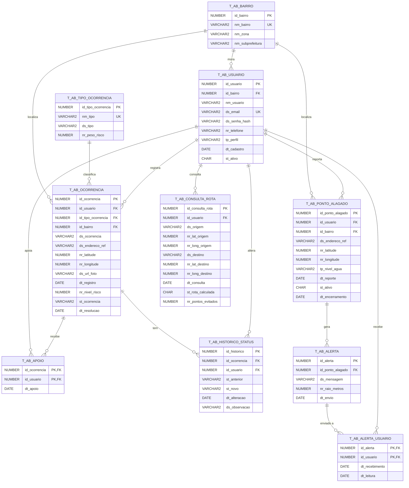
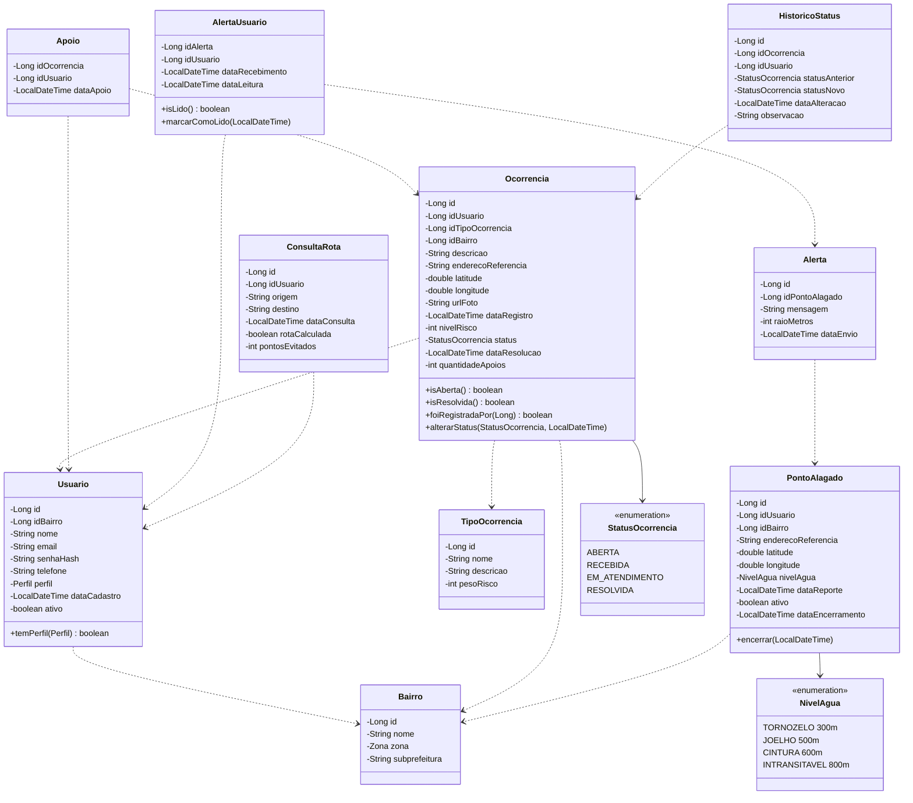

<div align="center">

# AlertaBairro

## API REST em Java — Domain Driven Design

### "Informe. Previna. Desvie."

**Global Solution 2026.2 — FIAP — Tema CitizenTech**

**Turma:** 2ESPG

| Integrante | RM |
|---|---|
| Arthur Araújo Tenório | RM562272 |
| Breno Gonçalves Báo | RM564037 |
| Rafael Falaguasta Ferraz | RM561714 |
| Vinicius Cavalcanti dos Reis | RM562063 |

**Repositório:** https://github.com/AlertaBairro/DDD-Java-GSCitizenTech

**Deploy (Render):** https://alertabairro-api.onrender.com

**Swagger:** https://alertabairro-api.onrender.com/swagger-ui.html

São Paulo — novembro de 2026

</div>

<div style="page-break-after: always;"></div>

## Sumário

1. Problema
2. Solução
3. Arquitetura em camadas
4. Modelo de dados
5. Regras de negócio
6. Endpoints
7. Tratamento de exceções
8. Testes
9. Deploy no Render
10. Como executar localmente
11. Evidências (prints)

---

## 1. Problema

Na região da **Subprefeitura Santana/Tucuruvi** (Jardim São Paulo, Santana, Tucuruvi, Parada Inglesa e Vila Mazzei), na zona norte de São Paulo, chuvas fortes transformam rapidamente bueiros entupidos e bocas de lobo danificadas em pontos de alagamento. Hoje:

- o morador só descobre que a rua alagou quando já está nela;
- as reclamações de zeladoria chegam dispersas, sem indicar o que é mais urgente;
- a subprefeitura não tem números para saber onde o problema se repete nem quanto tempo leva para resolvê-lo.

## 2. Solução

O **AlertaBairro** junta **zeladoria do bairro**, **alerta de alagamento** e **rota segura** em um só serviço. Esta entrega é a **API REST em Java**, construída sobre o **mesmo modelo de dados da entrega de Database do grupo**: as 10 tabelas `T_AB_*` do Oracle, sem nenhuma alteração.

| Perfil | Funcionalidades |
|---|---|
| **Morador** | Cadastra-se e faz login. Registra ocorrências de zeladoria e apoia as dos vizinhos. Reporta pontos alagados, que geram alertas para o bairro. Lê os próprios alertas e consulta a rota mais segura, que fica registrada. |
| **Agente de zeladoria** | Vê as ocorrências ordenadas por prioridade e muda o status, com histórico. Encerra pontos alagados. |
| **Gestor da subprefeitura** | Vê os indicadores de pendências, tempo de resolução, bairros, tipos, alertas, taxa de leitura e reincidência. Encerra pontos alagados. |

## 3. Arquitetura em camadas

```
            ┌───────────────────────────────┐
 HTTP  ───► │ controller (@RestController)  │ ◄── dto (records + Bean Validation)
            └──────────────┬────────────────┘
                           ▼
            ┌───────────────────────────────┐
            │ bo (regras de negócio)        │ ◄── model (1 classe por tabela + enums)
            └──────────────┬────────────────┘
                           ▼
            ┌───────────────────────────────┐
            │ dao (JDBC puro, transações)   │ ◄── ConnectionFactory (variáveis de ambiente)
            └──────────────┬────────────────┘
                           ▼
                 Oracle FIAP (tabelas T_AB_*)

   exception: @RestControllerAdvice + tradução dos erros ORA em JSON padronizado
```

| Pacote | Responsabilidade | Classes |
|---|---|---|
| `model` | Uma classe por tabela do DDL do grupo, com encapsulamento, construtores e getters/setters; enums para os CHECKs | `Bairro`, `Usuario`, `TipoOcorrencia`, `Ocorrencia`, `Apoio`, `HistoricoStatus`, `PontoAlagado`, `Alerta`, `AlertaUsuario`, `ConsultaRota`, `Zona`, `Perfil`, `StatusOcorrencia`, `NivelAgua`, `NivelRisco`, `AvaliacaoRisco` |
| `dao` | Acesso ao Oracle com `Connection`, `PreparedStatement` e `ResultSet`; um DAO por tabela; IDs pelas sequences `SQ_AB_*`; operações compostas em transação | `ConnectionFactory`, `JdbcUtils`, `BairroDAO`, `UsuarioDAO`, `TipoOcorrenciaDAO`, `OcorrenciaDAO`, `ApoioDAO`, `HistoricoStatusDAO`, `PontoAlagadoDAO`, `AlertaDAO`, `AlertaUsuarioDAO`, `ConsultaRotaDAO`, `IndicadorDAO`, `HealthDAO` |
| `bo` | Regras de negócio, validações e permissões por perfil | `UsuarioBO`, `CatalogoBO`, `OcorrenciaBO`, `ApoioBO`, `RiscoBO`, `PontoAlagadoBO`, `AlertaBO`, `RotaBO`, `IndicadorBO`, `HealthBO` |
| `controller` | Endpoints REST com GET, POST, PUT e DELETE; chamam somente o BO | `AuthController`, `UsuarioController`, `CatalogoController`, `OcorrenciaController`, `PontoAlagadoController`, `AlertaController`, `RotaController`, `IndicadorController`, `HealthController` |
| `dto` | Objetos de entrada e saída da API | `UsuarioCadastroRequest`, `LoginRequest`, `OcorrenciaRequest`, `StatusRequest`, `PontoAlagadoRequest`, `AvaliacaoRotaRequest`, respostas... |
| `exception` | Exceções próprias, tratador global e tradução dos erros do Oracle | `ValidacaoException`, `NaoAutenticadoException`, `AcessoNegadoException`, `RecursoNaoEncontradoException`, `ConflitoException`, `RegraDeNegocioException`, `PersistenciaException`, `GlobalExceptionHandler`, `TradutorErroOracle` |
| `config` | CORS, Swagger, BCrypt e relógio | `CorsConfig`, `OpenApiConfig`, `BeansConfig` |

**Segurança das credenciais:** a `ConnectionFactory` lê `DB_URL`, `DB_USER` e `DB_PASSWORD` de variáveis de ambiente. Nenhuma credencial está no código nem no repositório.

**Autenticação:** é simples, sem Spring Security nem JWT. O login devolve o id do usuário, e o front envia esse id no header `X-Usuario-Id`. O BO confere se o usuário existe, se está ativo e se o perfil tem permissão. As senhas ficam guardadas com hash **BCrypt**.

**Transações:** quando uma operação mexe em mais de uma tabela, ela roda numa única transação (`setAutoCommit(false)`, `commit` e `rollback` em caso de erro). São três casos:
- mudança de status junto com o histórico;
- ponto alagado junto com o alerta e os destinatários;
- exclusão de ocorrência junto com os apoios e o histórico.

[PRINT: estrutura de pacotes do projeto aberta no IntelliJ / VS Code]

## 4. Modelo de dados

### 4.1 Origem do modelo e scripts

O modelo é o da entrega de **Database** do grupo. Os scripts estão em `src/main/resources/db/`:

| Script | Origem | Conteúdo |
|---|---|---|
| `01_ddl.sql` | grupo (cópia exata) | criação das 10 tabelas, PKs, UKs, CHECKs e FKs |
| `02_dml.sql` | grupo (cópia exata) | 5 bairros, 10 usuários, 5 tipos, 8 ocorrências, apoios, histórico, 6 pontos alagados, alertas e consultas de rota |
| `03_api_complemento.sql` | API | sequences `SQ_AB_*` (começando em `MAX(id) + 1`), 3 usuários de teste com BCrypt real, 1 ocorrência ABERTA perto da estação e o morador de teste como destinatário do alerta 6 |
| `04_drop_api.sql` | API | desfaz o `03` |
| `05_dql.sql` | grupo (cópia exata) | consultas com INNER JOIN, GROUP BY e LEFT JOIN |
| `99_drop_esquema_antigo.sql` | API | remove as tabelas `AB_*` da primeira versão da API |

Ordem de execução: `01_ddl.sql`, depois `02_dml.sql`, depois `03_api_complemento.sql`. Na primeira execução, os `DROP TABLE` do início do DDL dão **ORA-00942** porque as tabelas ainda não existem. Isso é esperado e não impede a criação.

### 4.2 Tabelas e classes

| Tabela | Classe | Principais restrições |
|---|---|---|
| `T_AB_BAIRRO` | `Bairro` | PK, UNIQUE no nome, CHECK da zona |
| `T_AB_USUARIO` | `Usuario` | PK, UNIQUE no e-mail, CHECK do perfil e de `st_ativo` (S/N), FK para bairro |
| `T_AB_TIPO_OCORRENCIA` | `TipoOcorrencia` | PK, UNIQUE no nome, peso de risco de 1 a 5 |
| `T_AB_OCORRENCIA` | `Ocorrencia` | FKs para usuário, tipo e bairro; CHECK de latitude, longitude, risco (1 a 5), status e coerência RESOLVIDA ⇔ data de resolução |
| `T_AB_APOIO` | `Apoio` | PK composta (ocorrência, usuário) |
| `T_AB_HISTORICO_STATUS` | `HistoricoStatus` | CHECK dos status e de status anterior ≠ novo |
| `T_AB_PONTO_ALAGADO` | `PontoAlagado` | CHECK de coordenadas, nível da água e ativo ⇔ sem data de encerramento |
| `T_AB_ALERTA` | `Alerta` | FK para o ponto alagado, raio > 0 |
| `T_AB_ALERTA_USUARIO` | `AlertaUsuario` | PK composta (alerta, usuário), leitura ≥ recebimento |
| `T_AB_CONSULTA_ROTA` | `ConsultaRota` | CHECK de `st_rota_calculada` (S/N) e pontos evitados ≥ 0 |

Correspondência de tipos:
- `DATE` vira `LocalDateTime`;
- `NUMBER(9,6)` vira `double`, gravado com 6 casas;
- `CHAR(1)` 'S'/'N' vira `boolean`;
- os domínios dos CHECKs viram enums: `Zona`, `Perfil`, `StatusOcorrencia` e `NivelAgua`.

### 4.3 Diagrama entidade-relacionamento



[PRINT: modelo relacional das 10 tabelas no Oracle Data Modeler ou no SQL Developer]

### 4.4 Diagrama de classes (camada model)



## 5. Regras de negócio

Todas as regras ficam na camada **BO**.

1. **Cadastro de usuário** (público):
   - campos: nome, e-mail único (409 se já existir), senha (gravada como hash BCrypt), telefone opcional, bairro obrigatório e perfil;
   - o usuário entra ativo.
2. **Login:**
   - só autentica usuário existente, ativo e com senha válida; caso contrário, 401;
   - não cria conta;
   - devolve id, nome, perfil e bairro.
3. **Exclusão de usuário:**
   - é lógica (`st_ativo = 'N'`), porque o usuário é referenciado por várias FKs;
   - usuário inativo não loga.
4. **Registrar ocorrência** (MORADOR):
   - obrigatórios: tipo, bairro, endereço de referência, latitude e longitude;
   - descrição de até 500 caracteres e URL da foto opcional;
   - nasce **ABERTA**, com `nivelRisco` igual ao peso do tipo;
   - o autor não apoia a própria ocorrência; os apoios são contados em `T_AB_APOIO`.
5. **Editar e excluir ocorrência:**
   - só o autor, e só enquanto estiver ABERTA;
   - a exclusão remove antes os apoios e o histórico, na mesma transação.
6. **Apoiar e retirar apoio** (MORADOR):
   - um apoio por usuário (PK composta; 409 se repetir);
   - não é possível apoiar a própria ocorrência nem uma RESOLVIDA (422).
7. **Alterar status** (AGENTE):
   - o novo status precisa ser diferente do atual, e não é possível voltar para ABERTA (422);
   - grava uma linha em `T_AB_HISTORICO_STATUS` (agente, status anterior, status novo e observação) na mesma transação;
   - ir para RESOLVIDA preenche `dt_resolucao`; sair de RESOLVIDA limpa a data.
8. **Priorização do agente:**
   - `pontuação = nivelRisco × 2 + apoios + dias desde o registro × 0,8`, e uma ocorrência resolvida vale 0;
   - nível ALTO a partir de 16, MÉDIO a partir de 10;
   - a fila é decrescente e, no empate, vem primeiro a mais recente.
9. **Reportar ponto alagado** (MORADOR). Na mesma transação, a API:
   - cria o ponto ativo;
   - cria um alerta com a mensagem gerada a partir do endereço e do nível da água, e o raio dado pelo nível (TORNOZELO 300 m, JOELHO 500 m, CINTURA 600 m, INTRANSITAVEL 800 m);
   - registra como destinatários todos os usuários ativos do bairro, exceto quem reportou.
10. **Encerrar ponto alagado** (AGENTE ou GESTOR): `st_ativo = 'N'` e `dt_encerramento` igual ao momento atual.
11. **Alertas:**
    - lista os alertas ativos (de pontos ainda ativos);
    - lista os alertas recebidos pelo usuário, lidos e não lidos;
    - marca um alerta como lido gravando `dt_leitura`.
12. **Zonas de risco:** os pontos alagados ativos, cada um com raio de desvio de **40 m**. Esse raio é diferente do raio do alerta.
13. **Avaliar rota:**
    - uma rota atravessa a zona quando a distância do ponto até a polilinha é de no máximo 40 m;
    - o cálculo usa 110.540 m por grau de latitude, 111.320 × cos(lat) m por grau de longitude e a distância de ponto a segmento;
    - a mais segura é a que atravessa menos zonas e, no empate, a de menor duração;
    - a consulta é gravada em `T_AB_CONSULTA_ROTA`, com `st_rota_calculada` e `nr_pontos_evitados` (zonas da rota padrão − zonas da segura, no mínimo 0).
14. **Indicadores do gestor:**
    - total de ocorrências e total pendente;
    - tempo médio entre registro e resolução;
    - por bairro (a consulta 2 do DQL do grupo) e por tipo;
    - pontos alagados ativos e total;
    - alertas enviados, usuários alertados e taxa de leitura;
    - reincidência: pontos alagados repetidos no mesmo endereço, e combinações de bairro e tipo com mais de uma ocorrência.

**Exemplos com os dados do DML do grupo e do complemento** (calculados para 12/11/2026):
- **Priorização:** a ocorrência 2 (risco 4, 2 apoios, registrada em 12/10/2026) tem pontuação `4×2 + 2 + 31,1×0,8 ≈ 34,9`, portanto **risco alto**.
- **Indicadores:**
  - 9 ocorrências, 6 pendentes;
  - tempo médio de resolução ≈ 114 h ("4 d 18 h");
  - 1 ponto alagado ativo de 6;
  - 14 notificações entregues, com taxa de leitura de 64,3%;
  - reincidência no endereço "Av. Leôncio de Magalhães, em frente à Estação Jardim São Paulo" (2 reportes) e em "Jardim São Paulo + Bueiro entupido" (2 ocorrências).

## 6. Endpoints

| Método | Rota | Perfil | Descrição |
|---|---|---|---|
| GET | `/api/health` | público | status da API e do banco |
| GET | `/api/bairros` · `/api/bairros/{id}` | público | bairros |
| GET | `/api/tipos-ocorrencia` · `/api/tipos-ocorrencia/{id}` | público | tipos de ocorrência |
| POST | `/api/usuarios` | público | cadastro |
| GET / PUT / DELETE | `/api/usuarios/{id}` | o próprio | consultar, atualizar, exclusão lógica |
| POST | `/api/auth/login` | público | login |
| GET | `/api/ocorrencias?bairro=&tipo=&status=` | autenticado | lista com filtros |
| GET | `/api/ocorrencias/{id}` | autenticado | detalhe |
| POST | `/api/ocorrencias` | MORADOR | registrar |
| PUT / DELETE | `/api/ocorrencias/{id}` | autor, se ABERTA | editar / excluir |
| POST / DELETE | `/api/ocorrencias/{id}/apoios` | MORADOR | apoiar / retirar apoio |
| GET | `/api/ocorrencias/priorizadas` | AGENTE | fila por prioridade |
| PUT | `/api/ocorrencias/{id}/status` | AGENTE | alterar status + histórico |
| GET | `/api/ocorrencias/{id}/historico` | autenticado | histórico de status |
| GET | `/api/pontos-alagados?ativos=` | autenticado | todos ou só ativos |
| GET | `/api/pontos-alagados/{id}` | autenticado | detalhe |
| POST | `/api/pontos-alagados` | MORADOR | reportar (gera alerta) |
| PUT | `/api/pontos-alagados/{id}/encerrar` | AGENTE ou GESTOR | encerrar |
| GET | `/api/alertas` | autenticado | alertas ativos |
| GET | `/api/alertas/meus` | autenticado | alertas recebidos |
| PUT | `/api/alertas/{id}/leitura` | destinatário | marcar como lido |
| GET | `/api/zonas-de-risco` | autenticado | zonas de 40 m |
| POST | `/api/rotas/avaliar` | autenticado | avaliar rotas e gravar consulta |
| GET | `/api/rotas/minhas` | autenticado | histórico de consultas |
| GET | `/api/indicadores` | GESTOR | painel do gestor |

Ao todo são 24 rotas e 31 operações: 17 GET, 6 POST, 5 PUT e 3 DELETE. Os exemplos completos estão no `README.md` e no `requests.http`.

[PRINT: Swagger UI no Render com a lista de endpoints]

[PRINT: POST /api/usuarios respondendo 201]

[PRINT: POST /api/auth/login respondendo 200]

[PRINT: POST /api/ocorrencias respondendo 201 com status ABERTA]

[PRINT: GET /api/ocorrencias/priorizadas com o agente, mostrando pontuação e nível]

[PRINT: PUT /api/ocorrencias/{id}/status e GET /api/ocorrencias/{id}/historico]

[PRINT: POST /api/pontos-alagados com o alerta gerado e usuariosNotificados]

[PRINT: GET /api/alertas/meus e PUT /api/alertas/{id}/leitura]

[PRINT: POST /api/rotas/avaliar indicando a rota mais segura e pontosEvitados]

[PRINT: GET /api/indicadores com o gestor]

[PRINT: DELETE /api/ocorrencias/{id} respondendo 204]

## 7. Tratamento de exceções

A camada `exception` tem exceções próprias e o `GlobalExceptionHandler` (`@RestControllerAdvice`), que sempre devolve o mesmo formato JSON:

```json
{
  "timestamp": "2026-11-12T14:29:52-03:00",
  "status": 422,
  "erro": "Unprocessable Entity",
  "mensagem": "Não é possível voltar uma ocorrência para ABERTA.",
  "caminho": "/api/ocorrencias/9/status"
}
```

| Exceção | HTTP | Exemplo |
|---|---|---|
| `ValidacaoException` e Bean Validation | 400 | latitude fora da faixa, e-mail inválido (o campo `detalhes` traz os erros por campo) |
| `NaoAutenticadoException` | 401 | header ausente, usuário inativo, senha errada |
| `AcessoNegadoException` | 403 | agente registrando ocorrência; morador alterando status |
| `RecursoNaoEncontradoException` | 404 | ocorrência, ponto ou alerta inexistente |
| `ConflitoException` | 409 | e-mail já cadastrado, apoio duplicado; erro **ORA-00001** |
| `RegraDeNegocioException` | 422 | voltar para ABERTA, apoiar a própria ocorrência; erros **ORA-02290, ORA-02291, ORA-02292** |
| `PersistenciaException` e erros inesperados | 500 | falha no banco (o detalhe técnico fica só no log) |

O `TradutorErroOracle` lê o código ORA e o nome da constraint do modelo do grupo e devolve uma mensagem clara. Por exemplo, `UK_AB_USUARIO_EMAIL` vira "Já existe um usuário cadastrado com este e-mail.". Assim, uma violação de constraint vira 409 ou 422, e não 500.

[PRINT: resposta 409 ao apoiar a mesma ocorrência duas vezes]

[PRINT: resposta 422 ao tentar voltar uma ocorrência para ABERTA]

[PRINT: resposta 400 com o campo "detalhes" de validação]

## 8. Testes

São **86 testes unitários** com **JUnit 5 e Mockito**. Os DAOs ficam mockados, então os testes não precisam do banco.

| Classe de teste | O que cobre |
|---|---|
| `UsuarioBOTest` | cadastro (BCrypt, e-mail duplicado, bairro inexistente), login sem auto-cadastro, usuário inativo, hash fictício do DML, conferência dos hashes do `03_api_complemento.sql`, exclusão lógica, permissões |
| `OcorrenciaBOTest` | registro ABERTA com risco igual ao peso do tipo, sem apoio do autor; edição e exclusão só pelo autor e só em ABERTA; status com histórico; transições proibidas; data de resolução; concorrência; fila priorizada |
| `ApoioBOTest` | apoio, apoio na própria (422), em resolvida (422), duplicado (409), retirada |
| `RiscoBOTest` | fórmula, limites dos níveis, resolvida = 0, ordenação e desempate |
| `PontoAlagadoBOTest` | ponto + alerta + destinatários, raio por nível da água, mensagem, encerramento e permissões |
| `AlertaBOTest` | alertas ativos, alertas do usuário, marcar como lido (idempotente), 404 |
| `RotaBOTest` | zonas de 40 m, rota mais segura, pontos evitados, gravação da consulta, rota não calculada, geometria |
| `IndicadorBOTest` | composição do painel, taxa de leitura, formatação do tempo médio, acesso só do gestor |
| `ModeloTest`, `TradutorErroOracleTest`, `TransacaoTest` | regras da model, tradução dos ORA e commit/rollback das transações |

Execução: `./mvnw test`

[PRINT: saída do ./mvnw test com "Tests run: 86, Failures: 0"]

## 9. Deploy no Render

A aplicação é publicada no **Render** como Web Service **Docker**:

- `Dockerfile` multi-stage: build com Maven + JDK 21 e execução com JRE 21;
- a porta vem da variável `PORT` (`server.port=${PORT:8080}`);
- o `render.yaml` (Blueprint) declara o serviço, o health check `/api/health` e as variáveis de ambiente, sem os valores secretos.

Passo a passo:

1. Em https://dashboard.render.com, clique em **New → Web Service** e conecte o repositório do GitHub.
2. Escolha **Docker** como runtime, a branch `main` e o plano **Free**.
3. Cadastre as variáveis:
   - `DB_URL`: `jdbc:oracle:thin:@oracle.fiap.com.br:1521:ORCL`;
   - `DB_USER`;
   - `DB_PASSWORD`;
   - `CORS_ORIGINS`;
   - `TZ`: `America/Sao_Paulo`.
4. Defina o **Health Check Path** como `/api/health`.
5. Clique em **Create Web Service** e aguarde o build.
6. Teste `https://<serviço>.onrender.com/api/health` e `https://<serviço>.onrender.com/swagger-ui.html`.

**URL do deploy:** https://alertabairro-api.onrender.com

[PRINT: painel do Render com o serviço "Live"]

[PRINT: variáveis de ambiente cadastradas no Render (com a senha oculta)]

[PRINT: GET /api/health na URL pública mostrando "banco": "UP"]

## 10. Como executar localmente

1. Execute no Oracle, nesta ordem: `01_ddl.sql`, `02_dml.sql` e `03_api_complemento.sql`, da pasta `src/main/resources/db`. Se existirem tabelas `AB_*` da versão anterior, rode antes o `99_drop_esquema_antigo.sql`.
2. Defina as variáveis `DB_URL`, `DB_USER` e `DB_PASSWORD`.
3. Rode `./mvnw clean package` e depois `java -jar target/alertabairro-api.jar`.
4. Acesse `http://localhost:8080/swagger-ui.html`.

Usuários de teste:

| Perfil | E-mail | Senha |
|---|---|---|
| MORADOR | morador@alertabairro.com | morador123 |
| AGENTE | agente@alertabairro.com | agente123 |
| GESTOR | gestor@alertabairro.com | gestor123 |

[PRINT: tabelas T_AB_ e sequences SQ_AB_ criadas no SQL Developer]

[PRINT: SELECT na T_AB_HISTORICO_STATUS depois de uma mudança de status pela API]

[PRINT: SELECT na T_AB_ALERTA_USUARIO depois de reportar um ponto alagado pela API]

## 11. Evidências (prints)

Lista consolidada dos prints a inserir antes de gerar o PDF:

- [PRINT: estrutura de pacotes do projeto]
- [PRINT: modelo relacional das 10 tabelas]
- [PRINT: tabelas T_AB_, sequences e dados no SQL Developer]
- [PRINT: Swagger UI no Render]
- [PRINT: cadastro, login, registro, priorizadas, status + histórico, ponto alagado, alertas, rota e indicadores]
- [PRINT: respostas de erro 400, 409 e 422]
- [PRINT: ./mvnw test com 86 testes passando]
- [PRINT: serviço "Live" no Render, variáveis de ambiente e /api/health com banco UP]
