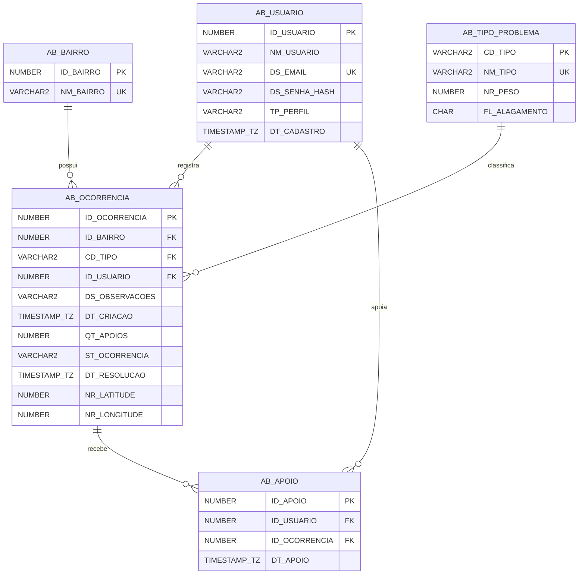
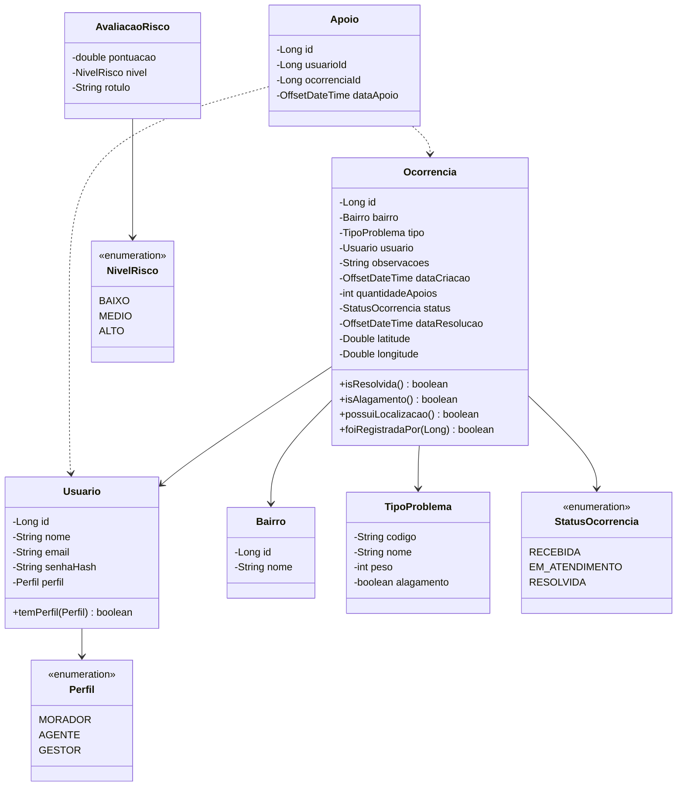

<div align="center">

# AlertaBairro

## API REST em Java — Domain Driven Design

### "Informe. Previna. Desvie."

**Global Solution 2026.2 — FIAP — Tema CitizenTech**

**Turma:** 2ESPG

| Integrante | RM |
|---|---|
| ________________________ | RM______ |
| ________________________ | RM______ |
| ________________________ | RM______ |

**Repositório:** https://github.com/AlertaBairro/DDD-Java-GSCitizenTech

**Deploy (Render):** https://________________.onrender.com

**Swagger:** https://________________.onrender.com/swagger-ui.html

São Paulo — novembro de 2026

</div>

<div style="page-break-after: always;"></div>

## Sumário

1. Problema
2. Solução
3. Arquitetura em camadas
4. Modelo de dados
5. Regras de negócio
6. Endpoints
7. Tratamento de exceções
8. Testes
9. Deploy no Render
10. Como executar localmente
11. Evidências (prints)

---

## 1. Problema

Nos bairros de **Santana, Jardim São Paulo e Tucuruvi**, na zona norte de São Paulo, chuvas fortes transformam rapidamente bueiros entupidos e bocas de lobo danificadas em pontos de alagamento. Hoje:

- o morador só descobre que a rua alagou quando já está nela;
- as reclamações de zeladoria chegam dispersas, sem indicar o que é mais urgente;
- a subprefeitura não tem números para saber onde o problema se repete nem quanto tempo leva para resolvê-lo.

## 2. Solução

O **AlertaBairro** junta **zeladoria do bairro**, **alerta de alagamento** e **rota segura** em um só serviço. Esta entrega é a **API REST em Java**, que substitui o `localStorage` do protótipo do front e concentra as regras de negócio em um banco **Oracle**.

| Perfil | Funcionalidades |
|---|---|
| **Morador** | Registra ocorrências (com ou sem ponto no mapa), apoia ocorrências de outros moradores, vê alertas de alagamento e avalia a rota mais segura. |
| **Agente de zeladoria** | Vê as ocorrências ordenadas por risco, filtra por bairro, tipo e status, e atualiza o status de cada uma. |
| **Gestor da subprefeitura** | Vê os indicadores de impacto: totais, tempo médio de resolução, alertas e reincidência. |

## 3. Arquitetura em camadas

A API segue as camadas trabalhadas em aula:

```
            ┌──────────────────────────┐
 HTTP  ───► │ controller (@RestController) │ ◄── dto (records + Bean Validation)
            └────────────┬─────────────┘
                         ▼
            ┌──────────────────────────┐
            │ bo (regras de negócio)    │ ◄── model (classes + enums)
            └────────────┬─────────────┘
                         ▼
            ┌──────────────────────────┐
            │ dao (JDBC puro)           │ ◄── ConnectionFactory (variáveis de ambiente)
            └────────────┬─────────────┘
                         ▼
                   Oracle FIAP (tabelas AB_)

   exception: @RestControllerAdvice converte as exceções em JSON padronizado
```

| Pacote | Responsabilidade | Classes |
|---|---|---|
| `model` | Classes que espelham as tabelas, com encapsulamento, construtores e getters/setters | `Usuario`, `Ocorrencia`, `Apoio`, `Bairro`, `TipoProblema`, `AvaliacaoRisco`, `Perfil`, `StatusOcorrencia`, `NivelRisco` |
| `dao` | Acesso ao Oracle com `Connection`, `PreparedStatement` e `ResultSet`; uma classe por tabela, com CRUD completo | `ConnectionFactory`, `UsuarioDAO`, `OcorrenciaDAO`, `ApoioDAO`, `BairroDAO`, `TipoProblemaDAO`, `HealthDAO` |
| `bo` | Regras de negócio, validações e permissões por perfil | `UsuarioBO`, `OcorrenciaBO`, `ApoioBO`, `RiscoBO`, `RotaBO`, `IndicadorBO`, `ReferenciaBO`, `HealthBO` |
| `controller` | Endpoints REST com GET, POST, PUT e DELETE; chamam somente o BO | `AuthController`, `UsuarioController`, `OcorrenciaController`, `AlertaController`, `RotaController`, `IndicadorController`, `ReferenciaController`, `HealthController` |
| `dto` | Objetos de entrada e saída da API | `LoginRequest`, `OcorrenciaRequest`, `OcorrenciaResponse`, `IndicadoresResponse`, ... |
| `exception` | Exceções próprias e tratador global | `ValidacaoException`, `NaoAutenticadoException`, `AcessoNegadoException`, `RecursoNaoEncontradoException`, `ConflitoException`, `RegraDeNegocioException`, `PersistenciaException`, `GlobalExceptionHandler` |
| `config` | CORS, Swagger, BCrypt e relógio | `CorsConfig`, `OpenApiConfig`, `BeansConfig` |

**Segurança das credenciais:** a `ConnectionFactory` lê `DB_URL`, `DB_USER` e `DB_PASSWORD` de variáveis de ambiente. Nenhuma credencial está no código nem no repositório.

**Autenticação:** simples, sem Spring Security nem JWT. O login devolve o id do usuário, que o front envia no header `X-Usuario-Id`; o BO confere se o perfil tem permissão para a operação. As senhas são guardadas com hash **BCrypt**.

[PRINT: estrutura de pacotes do projeto aberta no IntelliJ / VS Code]

## 4. Modelo de dados

### 4.1 Tabelas

| Tabela | Descrição | Principais restrições |
|---|---|---|
| `AB_BAIRRO` | Bairros atendidos | PK IDENTITY, UNIQUE no nome |
| `AB_TIPO_PROBLEMA` | Tipos com peso e indicação de alagamento | PK no código, CHECK do peso (1 a 10) e da flag (S/N) |
| `AB_USUARIO` | Moradores, agentes e gestores | PK IDENTITY, UNIQUE no e-mail, CHECK do perfil |
| `AB_OCORRENCIA` | Ocorrências registradas | PK IDENTITY, FKs para bairro, tipo e usuário, CHECK de status, apoios ≥ 0, latitude/longitude nas faixas válidas e coerência entre RESOLVIDA e data de resolução |
| `AB_APOIO` | Apoios dos moradores | PK IDENTITY, UNIQUE (usuário, ocorrência), FKs com ON DELETE CASCADE |

Dados de domínio carregados pelo `02_seed.sql`:

| Código | Tipo | Peso | Alagamento |
|---|---|---|---|
| ALAGADO | Ponto alagado | 5 | sim |
| BUEIRO | Bueiro entupido | 4 | não |
| BOCA | Boca de lobo danificada | 3 | não |
| LIXO | Lixo acumulado | 2 | não |

Status: RECEBIDA ("Recebida"), EM_ATENDIMENTO ("Em atendimento"), RESOLVIDA ("Resolvida").

### 4.2 Diagrama entidade-relacionamento



[PRINT: modelo relacional gerado no Oracle Data Modeler ou no SQL Developer]

### 4.3 Diagrama de classes (camada model)



## 5. Regras de negócio

Todas as regras ficam na camada **BO**.

1. **Registrar ocorrência** (somente MORADOR): bairro e tipo obrigatórios; nasce com status RECEBIDA e **1 apoio**, de quem registrou; data e hora geradas pelo sistema; se houver localização, latitude entre -90 e 90 e longitude entre -180 e 180, sempre informadas juntas. Observações opcionais, até 400 caracteres.
2. **Editar ocorrência:** somente o morador que registrou e somente enquanto RECEBIDA (bairro, tipo, observações e localização).
3. **Excluir ocorrência:** somente o autor e somente enquanto RECEBIDA; os apoios são removidos junto.
4. **Apoiar:** somente MORADOR; um apoio por usuário por ocorrência (409 se repetir); não é possível apoiar ocorrência RESOLVIDA (422); cada apoio soma 1 ao contador. **Retirar apoio** subtrai 1 (o autor não retira o próprio apoio).
5. **Alterar status** (somente AGENTE): ao mudar para RESOLVIDA grava a data de resolução; ao sair de RESOLVIDA, limpa essa data.
6. **Cálculo de risco:**
   - RESOLVIDA: pontuação 0, nível BAIXO, rótulo "Resolvido";
   - demais: `pontuação = peso_do_tipo × 2 + apoios + dias_desde_criação × 0,8`;
   - nível: `≥ 16` ALTO, `≥ 10` MÉDIO, abaixo BAIXO;
   - a lista do agente vem ordenada por pontuação decrescente e, no empate, pela mais recente.
7. **Alertas de alagamento ativos:** ocorrências ALAGADO não resolvidas, da mais recente para a mais antiga.
8. **Zonas de risco:** ocorrências ALAGADO não resolvidas e com localização, cada uma com raio de **40 m**.
9. **Avaliação de rota:** o front calcula as rotas (OSRM) e envia as coordenadas. A API conta, para cada rota, quantas zonas de risco ela atravessa (distância da zona até a polilinha ≤ 40 m, usando 110.540 m por grau de latitude, 111.320 × cos(lat) m por grau de longitude e distância de ponto a segmento). A mais segura é a que atravessa menos zonas e, no empate, a de menor duração.
10. **Indicadores do gestor:** total de ocorrências, total em aberto, tempo médio entre registro e resolução (só das resolvidas), total de alertas de alagamento, contagem por bairro, por tipo e por status, e **reincidência** (combinações bairro + tipo com mais de uma ocorrência).
11. **Login:** valida o formato do e-mail e se a senha foi informada. Se o e-mail não existir, cria o usuário com o perfil escolhido; o nome é derivado do e-mail (parte antes do `@`, com `.`, `_` e `-` trocados por espaço, em Title Case). Se existir, confere a senha com BCrypt e exige o mesmo perfil.

**Exemplo de risco com os dados iniciais:** a ocorrência 1 (BUEIRO, peso 4, 9 apoios, registrada há 52 h) tem pontuação `4×2 + 9 + (52/24)×0,8 ≈ 18,7`, portanto **risco alto**.

## 6. Endpoints

| Método | Rota | Perfil | Descrição |
|---|---|---|---|
| GET | `/api/health` | público | status da API e do banco |
| POST | `/api/auth/login` | público | login (e-mail, senha, perfil) |
| GET | `/api/usuarios/{id}` | autenticado | dados do usuário |
| PUT | `/api/usuarios/{id}` | o próprio | atualizar nome/senha |
| DELETE | `/api/usuarios/{id}` | o próprio | excluir conta |
| GET | `/api/referencias` | público | bairros, tipos, status, perfis e ponto de referência |
| GET | `/api/ocorrencias?bairro=&tipo=&status=` | autenticado | lista com filtros |
| GET | `/api/ocorrencias/{id}` | autenticado | detalhe |
| POST | `/api/ocorrencias` | MORADOR | registrar |
| PUT | `/api/ocorrencias/{id}` | autor, se RECEBIDA | editar |
| DELETE | `/api/ocorrencias/{id}` | autor, se RECEBIDA | excluir |
| POST | `/api/ocorrencias/{id}/apoios` | MORADOR | apoiar |
| DELETE | `/api/ocorrencias/{id}/apoios` | MORADOR | retirar apoio |
| GET | `/api/ocorrencias/priorizadas` | AGENTE | lista ordenada por risco |
| PUT | `/api/ocorrencias/{id}/status` | AGENTE | alterar status |
| GET | `/api/alertas` | autenticado | alertas de alagamento ativos |
| GET | `/api/zonas-de-risco` | autenticado | pontos alagados ativos + raio |
| POST | `/api/rotas/avaliar` | autenticado | avalia rotas candidatas |
| GET | `/api/indicadores` | GESTOR | KPIs, contagens e reincidência |

Cada ocorrência devolvida informa `apoiadaPorMim` (o usuário do header já apoiou), `minhaOcorrencia`, `editavel` e o `risco` calculado (pontuação, nível e rótulo).

Os exemplos completos de requisição e resposta estão no `README.md` e no arquivo `requests.http`.

[PRINT: Swagger UI no Render com a lista de endpoints]

[PRINT: POST /api/auth/login respondendo 200 no Swagger]

[PRINT: POST /api/ocorrencias respondendo 201]

[PRINT: GET /api/ocorrencias/priorizadas com o agente, mostrando pontuação e nível]

[PRINT: PUT /api/ocorrencias/{id}/status mudando para RESOLVIDA]

[PRINT: DELETE /api/ocorrencias/{id} respondendo 204]

[PRINT: POST /api/rotas/avaliar indicando a rota mais segura]

[PRINT: GET /api/indicadores com o gestor]

## 7. Tratamento de exceções

A camada `exception` tem exceções próprias e o `GlobalExceptionHandler` (`@RestControllerAdvice`), que devolve sempre o mesmo formato JSON:

```json
{
  "timestamp": "2026-11-12T14:29:52-03:00",
  "status": 422,
  "erro": "Unprocessable Entity",
  "mensagem": "Não é possível apoiar uma ocorrência resolvida.",
  "caminho": "/api/ocorrencias/5/apoios"
}
```

| Exceção | HTTP | Exemplo |
|---|---|---|
| `ValidacaoException` e erros de Bean Validation | 400 | latitude fora da faixa, e-mail inválido (campo `detalhes` com os erros por campo) |
| `NaoAutenticadoException` | 401 | header `X-Usuario-Id` ausente, usuário inexistente, senha errada |
| `AcessoNegadoException` | 403 | agente tentando registrar ocorrência; morador editando ocorrência de outro |
| `RecursoNaoEncontradoException` | 404 | ocorrência, usuário, bairro ou tipo inexistente |
| `ConflitoException` | 409 | apoio duplicado |
| `RegraDeNegocioException` | 422 | apoiar ocorrência resolvida; editar fora de RECEBIDA |
| `PersistenciaException` e erros inesperados | 500 | falha no banco (o detalhe técnico vai só para o log) |

[PRINT: resposta 409 ao apoiar a mesma ocorrência duas vezes]

[PRINT: resposta 400 com o campo "detalhes" de validação]

## 8. Testes

São **54 testes unitários** com **JUnit 5 e Mockito** sobre os BOs, com os DAOs mockados (não precisam do banco):

| Classe de teste | O que cobre |
|---|---|
| `RiscoBOTest` | fórmula, limites dos níveis, resolvida = 0, ordenação e desempate |
| `OcorrenciaBOTest` | registro, validação de coordenadas, permissões, edição/exclusão só em RECEBIDA, transições de status e data de resolução, `apoiadaPorMim`, alertas |
| `ApoioBOTest` | apoio, apoio duplicado (409), apoio em resolvida (422), retirada de apoio |
| `UsuarioBOTest` | login, criação de conta, BCrypt, nome derivado, perfis e exclusão de conta |
| `RotaBOTest` | distância ponto–segmento, zonas atravessadas, rota mais segura e desempate por duração |
| `IndicadorBOTest` | totais, tempo médio (50 h no seed), contagens e reincidência |

Execução: `./mvnw test`

[PRINT: saída do ./mvnw test com "Tests run: 54, Failures: 0"]

## 9. Deploy no Render

A aplicação é publicada no **Render** como Web Service **Docker**:

- `Dockerfile` multi-stage: build com Maven + JDK 21 e runtime com JRE 21;
- a porta vem da variável `PORT` (`server.port=${PORT:8080}`);
- `render.yaml` (Blueprint) declara o serviço, o health check `/api/health` e as variáveis de ambiente, sem os valores secretos.

Passo a passo:

1. Em https://dashboard.render.com, clique em **New → Web Service** e conecte o repositório do GitHub.
2. Escolha **Docker** como runtime, branch `main` e plano **Free**.
3. Cadastre as variáveis `DB_URL` (`jdbc:oracle:thin:@oracle.fiap.com.br:1521:ORCL`), `DB_USER`, `DB_PASSWORD` e `CORS_ORIGINS`.
4. Defina o **Health Check Path** como `/api/health`.
5. Clique em **Create Web Service** e aguarde o build.
6. Teste `https://<serviço>.onrender.com/api/health` e `https://<serviço>.onrender.com/swagger-ui.html`.

**URL do deploy:** https://________________.onrender.com

[PRINT: painel do Render com o serviço "Live"]

[PRINT: variáveis de ambiente cadastradas no Render (com a senha oculta)]

[PRINT: GET /api/health na URL pública mostrando "banco": "UP"]

## 10. Como executar localmente

1. Execute no Oracle, em ordem: `00_drop.sql` (opcional), `01_ddl.sql` e `02_seed.sql` (pasta `src/main/resources/db`).
2. Defina as variáveis `DB_URL`, `DB_USER` e `DB_PASSWORD`.
3. Rode `./mvnw clean package` e `java -jar target/alertabairro-api.jar`.
4. Acesse `http://localhost:8080/swagger-ui.html`.

Credenciais de teste:

| Perfil | E-mail | Senha |
|---|---|---|
| MORADOR | morador@alertabairro.com | morador123 |
| AGENTE | agente@alertabairro.com | agente123 |
| GESTOR | gestor@alertabairro.com | gestor123 |

[PRINT: tabelas AB_ criadas no SQL Developer]

[PRINT: SELECT * FROM AB_OCORRENCIA com os dados iniciais]

## 11. Evidências (prints)

Lista consolidada dos prints a inserir antes de gerar o PDF:

- [PRINT: estrutura de pacotes do projeto]
- [PRINT: modelo relacional]
- [PRINT: tabelas AB_ e dados iniciais no SQL Developer]
- [PRINT: Swagger UI no Render]
- [PRINT: login, registro, priorizadas, status, exclusão, rota e indicadores]
- [PRINT: respostas de erro 400 e 409]
- [PRINT: ./mvnw test com 54 testes passando]
- [PRINT: serviço "Live" no Render, variáveis de ambiente e /api/health com banco UP]
